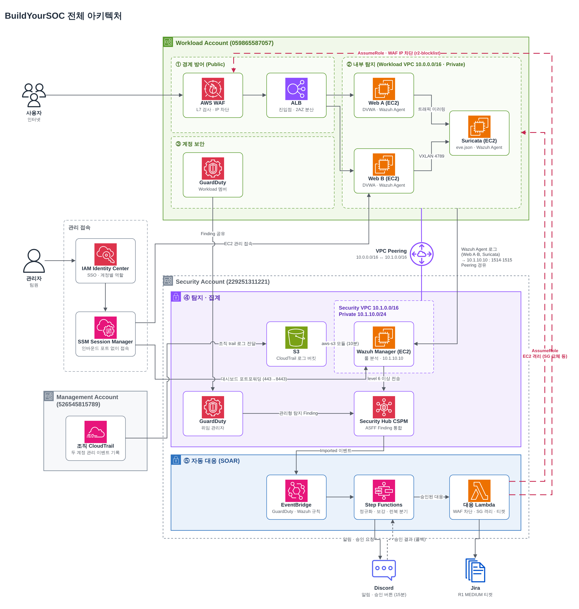

<div align="center">

# 🛡️ BYOC — AWS Multi-Account SOC

**AWS 멀티 계정 환경에 SOC를 직접 구축하고,<br>CloudTrail 기반으로 IAM 권한상승을 탐지·대응한 프로젝트**

<br>


<br>

[📐 아키텍처](#-아키텍처) · [🙋 내 역할](#-내-역할) · [🎯 시나리오](#-공격-시나리오와-런북) · [📝 사고 분석 보고서](reports/R3-incident-report.md) · [💭 회고](#-회고)

</div>

<br>

## 📌 프로젝트 개요

| 항목 | 내용 |
|---|---|
| **프로그램** | 화이트햇스쿨 4기 · Build Your Own SOC |
| **팀** | SOCing (교육생 8명 · 멘토 1명 · PL 1명) |
| **기간** | 2026.08 – 2026.10 (10주) |
| **환경** | AWS Organizations (Management · Security · Workload 계정 분리) |
| **내 역할** | <!-- TODO: 한 줄 요약 --> Security 계정 구축 · CloudTrail 탐지 파이프라인 · IAM 권한상승 시나리오 |

> <!-- TODO: 프로젝트 목표를 2~3문장으로 -->

<br>

## 📐 아키텍처


  

### 탐지 데이터 흐름

| 줄기 | 경로 | 탐지 대상 |
|---|---|---|
| **A** | 서버 내부 → Wazuh Agent → Manager → Security Hub | 웹 공격, FIM, 셸 실행 |
| **GuardDuty** | AWS 이상 행위 → Security Hub | C2 통신, 자격증명 이상 |
| **B** 🙋 | CloudTrail → S3 → Wazuh → Security Hub | IAM 권한상승 등 클라우드 API 공격 |

<br>

## 🙋 내 역할

> 팀 프로젝트 중 **직접 설계·구현한 부분**입니다. 폴더에 🙋 표시가 있는 곳이 담당 영역입니다.

| 영역 | 한 일 | 결과물 |
|---|---|---|
| Security 계정 인프라 | <!-- TODO --> | [`infra/security-account`](infra/security-account) |
| 조직 구성 | <!-- TODO --> | [`infra/organization`](infra/organization) |
| CloudTrail 탐지 파이프라인 | <!-- TODO --> | [`detection/cloudtrail-pipeline`](detection/cloudtrail-pipeline) |
| Wazuh → Security Hub 연동 | <!-- TODO --> | [`integration/wazuh-to-securityhub`](integration/wazuh-to-securityhub) |
| IAM 권한상승 시나리오 | <!-- TODO --> | [`attack-sim/privesc`](attack-sim/privesc) |
| R3 런북 · 사고 분석 | <!-- TODO --> | [`reports/`](reports) |

<br>

## 🎯 공격 시나리오와 런북

### 런북 분류

| 런북 | 대상 | 대응 방식 |
|---|---|---|
| **R1** | MEDIUM 이하 | <!-- TODO --> |
| **R2** | 웹 공격 (SQLi · Brute Force) | <!-- TODO --> |
| **R3** 🙋 | IAM 자격증명 · 권한상승 | <!-- TODO --> |
| **R4** | EC2 워크로드 (웹셸 · 백도어) | <!-- TODO --> |
| **R5** | 데이터 유출 | <!-- TODO --> |
| **R6** | 미분류 Finding | <!-- TODO --> |
| **R7** | <!-- TODO --> | <!-- TODO --> |

### 시나리오 검증 결과

| # | 공격 | 탐지원 | 런북 | 결과 |
|---|---|---|---|---|
| S-1 | 정찰 (포트스캔 · 디렉터리 스캔) | | | |
| S-2 | Brute Force | | | |
| S-3 | SQLi · XSS | | | |
| S-4 | 웹셸 | | | |
| S-5 | C2 | | | |
| S-6 🙋 | IAM 권한상승 | | R3 | |
| S-7 | 데이터 유출 | | | |
| S-8 | 채굴 | | | |
| S-9 | TCP DoS | | | |

<br>

## 🧰 기술 스택

| 분류 | 사용 기술 |
|---|---|
| **IaC** | Terraform |
| **탐지** | Wazuh · Suricata · GuardDuty · AWS WAF |
| **수집·집계** | CloudTrail (Organization Trail) · S3 · Security Hub (ASFF) |
| **대응 자동화** | EventBridge · Step Functions · Lambda |
| **접근 통제** | IAM Identity Center · SCP · SSM Session Manager |

<br>

## 📂 저장소 구조

```
byoc-aws-soc/
├── docs/                      설계 문서 · 다이어그램
├── infra/
│   ├── security-account/      🙋 Security 계정 Terraform · VPC Peering
│   └── organization/          🙋 Organization Trail · SCP · GuardDuty 위임
├── detection/
│   ├── wazuh/                 Wazuh 커스텀 룰 · 디코더
│   ├── suricata/              Suricata 커스텀 룰
│   └── cloudtrail-pipeline/   🙋 CloudTrail → S3 → Wazuh
├── integration/
│   └── wazuh-to-securityhub/  🙋 Wazuh alert → ASFF 변환기
├── response/
│   ├── stepfunctions/         대응 워크플로 정의
│   ├── lambda/                대응 Lambda
│   └── runbooks/              런북 (R1 ~ R7)
├── attack-sim/
│   └── privesc/               🙋 IAM 권한상승 재현
└── reports/                   🙋 사고 분석 보고서
```

<br>

## 💭 회고

### 배운 점
<!-- TODO -->

### 아쉬운 점과 개선 방향
<!-- TODO -->

<br>

## 🔗 관련 글

| 글 | 링크 |
|---|---|
| CloudTrail 권한상승 룰이 울리지 않았던 3가지 이유 | <!-- TODO --> |
| EC2 역할 하나로 Admin까지: PassRole 권한상승 재현기 | <!-- TODO --> |
| 크로스 계정 Wazuh 구축기 | <!-- TODO --> |

<br>

---

<div align="center">

**김신우** · [GitHub @shinu61](https://github.com/shinu61) <!-- TODO: 블로그 · 이메일 -->

<sub>※ 계정 ID · IP · 자격증명 등 민감 정보는 모두 마스킹 처리되었습니다.</sub>

</div>
