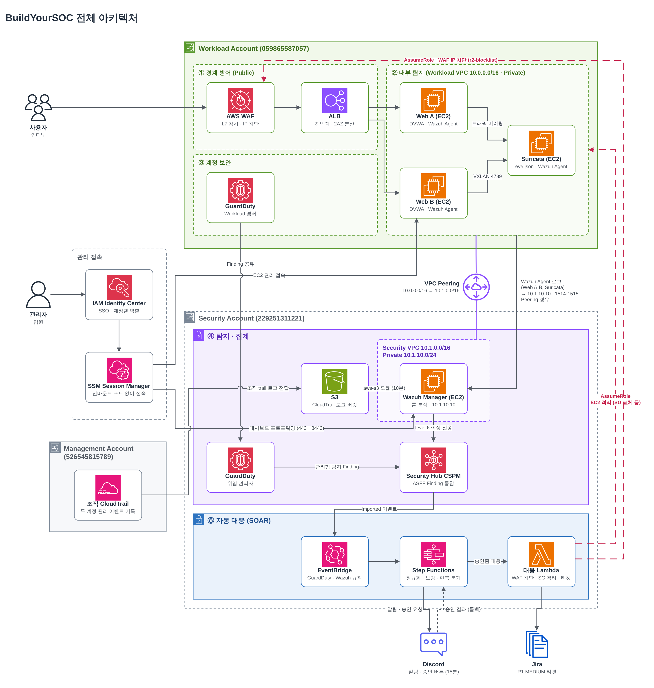

<div align="center">

# 🛡️ BYOC — AWS Multi-Account SOC

**AWS 멀티 계정 환경에 SOC를 직접 구축하고,<br>CloudTrail 기반으로 IAM 권한상승을 탐지·대응한 프로젝트**

<br>


<br>

[📐 아키텍처](#-아키텍처) · [🙋 내 역할](#-내-역할) · [🎯 시나리오](#-공격-시나리오와-런북) · [📝 사고 분석 보고서](reports/R3-incident-report.md) · [💭 회고](#-회고)

</div>

<br>

## 📌 프로젝트 개요

| 항목 | 내용 |
|---|---|
| **프로그램** | 화이트햇스쿨 4기 · Build Your Own SOC |
| **팀** | SOCing (교육생 8명 · 멘토 1명 · PL 1명) |
| **기간** | 2026.08 – 2026.10 (10주) |
| **환경** | AWS Organizations (Management · Security · Workload 계정 분리) |
| **내 역할** | <!-- TODO: 한 줄 요약 --> Security 계정 구축 · CloudTrail 탐지 파이프라인 · IAM 권한상승 시나리오 |

> <!-- TODO: 프로젝트 목표를 2~3문장으로 -->

<br>

## 📐 아키텍처

  

### 탐지 데이터 흐름

| 줄기 | 경로 | 탐지 대상 |
|---|---|---|
| **A** | 서버 내부 → Wazuh Agent → Manager → Security Hub | 웹 공격, FIM, 셸 실행 |
| **GuardDuty** | AWS 이상 행위 → Security Hub | C2 통신, 자격증명 이상 |
| **B** 🙋 | CloudTrail → S3 → Wazuh → Security Hub | IAM 권한상승 등 클라우드 API 공격 |

<br>

## 🙋 내 역할

> 팀 프로젝트 중 **직접 설계·구현한 부분**입니다. 폴더에 🙋 표시가 있는 곳이 담당 영역입니다.

| 영역 | 한 일 | 결과물 |
|---|---|---|
| Security 계정 인프라 | public subnet(10.1.0.0/24)및 private subnet(10.1.10.0/24셋팅 | [`infra/security-account`](infra/security-account) |
| CloudTrail 탐지 파이프라인 (Organization Trail ~ 탐지 룰) | 조직트레일 생성 및 조직트레일->s3->Wazuh(aws-s3 모듈)설정 | [`detection/cloudtrail-pipeline`](detection/cloudtrail-pipeline) |
| Wazuh → Security Hub 연동 | 연동 방향 설계(Wazuh → Security Hub) 후 ASFF 변환기 개발 | [`integration/wazuh-to-securityhub`](integration/wazuh-to-securityhub) |
| IAM 권한상승 시나리오 | Rule 100300,100301 개발 | [`attack-sim/privesc`](attack-sim/privesc) |
| R3 런북(탐지·판단 파트) 작성 | 심각도 판정 기준·조사 절차·대응 대상 구분 정의 | [`reports/`](reports) |

<br>

## 🎯 공격 시나리오와 런북

### 런북 분류

Finding은 **심각도로 먼저** 나누고(MEDIUM 이하 → R1), HIGH 이상은 **ATT&CK 전술(category)** 에 따라 R2~R6로 보냅니다.

| 런북 | 대상 | 분류 조건 | 대응 방식 |
|---|---|---|---|
| **R1** | 조사 · 티켓 | 심각도 MEDIUM · LOW · INFORMATIONAL | MEDIUM은 Jira 티켓 발행 + Discord 알림, LOW · INFO는 기록 |
| **R2** | 웹 진입 · 탐색 | Initial Access · Reconnaissance | HIGH는 승인 후 WAF IP 차단, CRITICAL은 자동 차단 |
| **R3** 🙋 | IAM 자격증명 · 권한상승 | Credential Access · `AwsIamAccessKey` | 명시적 Deny로 역할 세션 무효화, 공격 리소스 삭제, 취약 권한 회수 |
| **R4** | 침해 워크로드 | Command and Control (+ TorClient 등 지정 유형) | Discord 승인 후 격리 SG 교체, TCP DoS는 SG · NACL · IAM 격리 |
| **R5** | 데이터 · 서비스 | Exfiltration · Impact | 승인 분기 후 판단 결과 기록 (승인 · 오탐 · 허용 활동) |
| **R6** | 미분류 | 위 조건에 맞지 않는 Finding | 원문 보존, 수동 재분류, 분류 규칙 보완 |

### 시나리오 검증 결과

| # | 공격 | ATT&CK | 탐지 | 런북 | 결과 |
|---|---|---|---|---|---|
| S-1 | 정찰 (포트스캔 · 디렉터리 스캔) | T1595 · T1046 | Suricata → Wazuh 100113, Wazuh 31151 | R1 | ✅ 탐지 · 기록 |
| S-2 | SQLi · XSS | T1190 | Wazuh 100120 (HIGH), 100131 (CRITICAL) | R2 | ✅ CRITICAL 자동 차단, 차단 후 재공격 20회 모두 403 |
| S-3 | 웹셸 업로드 · 실행 | T1505.003 | Wazuh FIM 100110~100112, auditd 100220 | R6 → R4 | ✅ HIGH 알림 · 대응 Lambda 실행 |
| S-4 | 리버스셸 · C2 | T1071 · T1571 | GuardDuty `C&CActivity.B!DNS` | R4 | ✅ 탐지 |
| S-5 🙋 | IMDS 자격증명 탈취 | T1552.005 | GuardDuty, CloudTrail | R3 | ✅ 탈취 키 사용이 CloudTrail에 기록 → S-6 룰로 탐지 |
| S-6 🙋 | IAM 권한상승 (PassRole + Lambda) | T1078.004 · T1548 | CloudTrail → Wazuh 100300 · 100301 (CRITICAL) | R3 | ✅ 탐지 · R3 분기 · IAM 격리 |
| S-7 | 데이터 유출 | T1567 · T1048 | GuardDuty `DNSDataExfiltration` | R5 | 🧪 샘플 Finding으로 분기 · 판단 기록 검증 |
| S-8 | 암호화폐 채굴 | T1496 | GuardDuty `BitcoinTool.B` | R4 | ✅ Discord 승인 → 격리 SG 교체 |
| S-9 | 내부 TCP SYN DoS | — | Suricata → Wazuh 100114 | R4 | ✅ SG · NACL 격리와 복구 확인 (테스트 상태 머신) |

<sub>✅ 실제 공격 재현(E2E) · 🧪 샘플 데이터 단위 검증</sub>

<br>

## 🧰 기술 스택

| 분류 | 사용 기술 |
|---|---|
| **IaC** | Terraform |
| **탐지** | Wazuh · Suricata · GuardDuty · AWS WAF |
| **수집·집계** | CloudTrail (Organization Trail) · S3 · Security Hub (ASFF) |
| **대응 자동화** | EventBridge · Step Functions · Lambda |
| **접근 통제** | IAM Identity Center · SCP · SSM Session Manager |

<br>

## 📂 저장소 구조

```
byoc-aws-soc/
├── docs/                      설계 문서 · 다이어그램
├── infra/
│   ├── security-account/      🙋 Security 계정 Terraform · VPC Peering
│   └── organization/          계정 구조 · SCP · GuardDuty 위임 (팀)
├── detection/
│   ├── wazuh/                 Wazuh 커스텀 룰 · 디코더
│   ├── suricata/              Suricata 커스텀 룰
│   └── cloudtrail-pipeline/   🙋 Organization Trail → S3 → Wazuh
├── integration/
│   └── wazuh-to-securityhub/  🙋 Wazuh alert → ASFF 변환기
├── response/
│   ├── stepfunctions/         대응 워크플로 정의
│   ├── lambda/                대응 Lambda
│   └── runbooks/              런북 (R1 ~ R6)
├── attack-sim/
│   └── privesc/               🙋 IAM 권한상승 재현
└── reports/                   🙋 사고 분석 보고서
```

<br>

## 💭 회고

### 배운 점
<!-- TODO -->

### 아쉬운 점과 개선 방향
<!-- TODO -->

<br>

## 🔗 관련 글

| 글 | 링크 |
|---|---|
| CloudTrail 권한상승 룰이 울리지 않았던 3가지 이유 | <!-- TODO --> |
| EC2 역할 하나로 Admin까지: PassRole 권한상승 재현기 | <!-- TODO --> |
| 크로스 계정 Wazuh 구축기 | <!-- TODO --> |

<br>

---

<div align="center">

**김신우** · [GitHub @shinu61](https://github.com/shinu61) <!-- TODO: 블로그 · 이메일 -->

<sub>※ 계정 ID · IP · 자격증명 등 민감 정보는 모두 마스킹 처리되었습니다.</sub>

</div>
