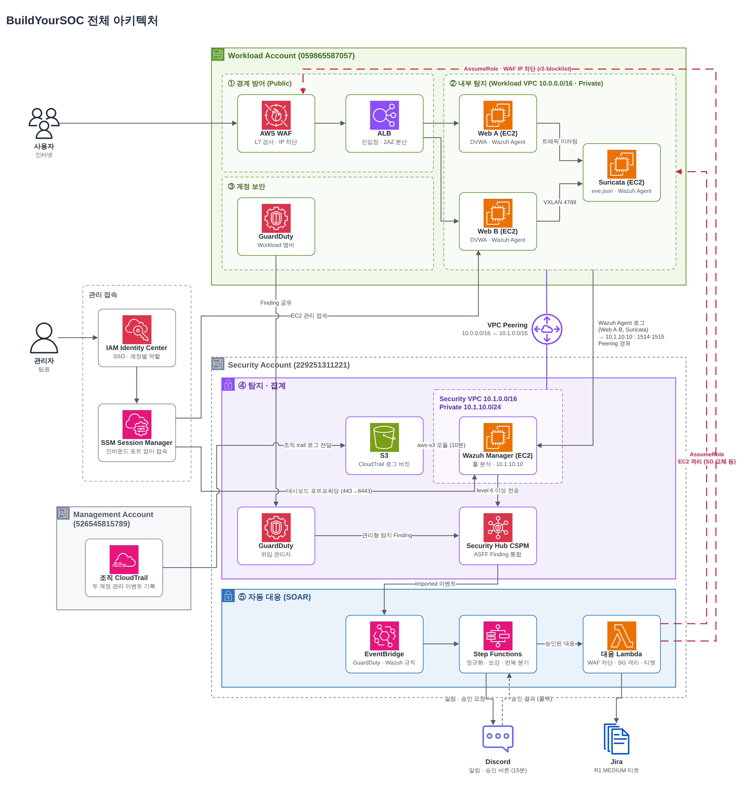

# 📐 설계 문서

프로젝트 설계 근거를 정리했습니다. 원문은 팀 설계문서(BuildYourSOC 설계문서)입니다.

> 🔒 커밋 전에 [마스킹 체크리스트](masking-checklist.md)를 확인하세요.

## 설계 목표

| 목표 | 내용 |
|---|---|
| **3계층 관측** | 클라우드(API) · 네트워크 · 호스트를 각각 다른 솔루션으로 관측해, 한 계층이 놓친 공격을 다른 계층이 잡는다 |
| **탐지 자산 보호** | 공격 대상과 탐지 · 로그 자산을 계정 단위로 분리한다 |
| **탐지 결과 단일화** | 모든 탐지 결과를 Security Hub에 ASFF로 모아 한 곳에서 대응을 시작한다 |
| **승인 기반 자동 대응** | 차단 · 격리는 자동화하되, 오탐으로 서비스가 멈추지 않도록 HIGH는 사람이 승인한 뒤 실행한다 |
| **공격으로 검증** | 각 탐지와 대응은 공격 시나리오를 실행해 동작을 확인한다 |

### 계층별 관측

| 계층 | 답해야 할 질문 | 관측 대상 | 솔루션 |
|---|---|---|---|
| 클라우드 | 누가 AWS에서 어떤 활동을 했는가 | CloudTrail, IAM | GuardDuty, Security Hub, Wazuh (aws-s3) |
| 네트워크 | 어떤 데이터가 들어오고 나가는가 | ALB, 미러링 트래픽 | AWS WAF, Suricata |
| 호스트 | 서버 안에서 무슨 일이 일어나는가 | Apache 로그, auditd, 파일 무결성 | Wazuh Agent |

## 아키텍처 다이어그램

| 영역 | 구성요소 | 역할 |
|---|---|---|
| ① 경계 방어 | AWS WAF, ALB | L7 검사, 진입점 단일화, 승인된 공격 IP 차단 |
| ② 내부 탐지 | Web A · B (DVWA + Wazuh Agent), Suricata | 호스트 로그, 파일 변경, 네트워크 트래픽 수집 |
| ③ 계정 보안 | GuardDuty (Workload 멤버) | API · 네트워크 · DNS 이상행위 탐지 |
| ④ 탐지 · 집계 | Wazuh Manager, GuardDuty (위임 관리자), CloudTrail S3, Security Hub | 모든 탐지 결과를 ASFF로 모음 |
| ⑤ 자동 대응 | EventBridge, Step Functions, 대응 Lambda, Discord, Jira | 정규화, 런북 분기, 승인, 차단 · 격리, 티켓 |

## 계정 구조

| 계정 | 계정 ID | 역할 | 주요 리소스 |
|---|---|---|---|
| Management | 526545815789 | Organizations 관리, 위임 관리자 지정 | 조직 Trail `buildyoursoc-org-trail` |
| Workload | 059865587057 | 공격 대상 서비스 | ALB, WAF, Web A/B, RDS, Suricata, NAT |
| Security | 229251311221 | 감시 · 탐지 · 기록 · 자동 대응 | Wazuh Manager, CloudTrail 버킷, Security Hub, Step Functions, Lambda, 증거 S3 |

## 네트워크 구성

| 구성요소 | 계정 | 주소 | 용도 |
|---|---|---|---|
| VPC | Workload | 10.0.0.0/16 | 웹 서비스 영역 |
| Private 서브넷 A · B | Workload | 10.0.10.0/24 · 10.0.11.0/24 | Web A + Suricata · Web B |
| VPC | Security | 10.1.0.0/16 | Workload와 겹치지 않게 (Peering 조건) |
| Public 서브넷 | Security | 10.1.0.0/24 | NAT Instance, IGW |
| Private 서브넷 | Security | 10.1.10.0/24 | Wazuh Manager (10.1.10.10) |
| VPC Peering | 양쪽 | Workload ↔ Security | Agent → Manager 로그 전송 (1514 · 1515만 허용) |

| Security Group | 허용 | 출처 | 이유 |
|---|---|---|---|
| Wazuh Manager | TCP 1514 · 1515 | Workload Private 서브넷 | Agent 통신만. 대시보드는 SSM 포트포워딩 |
| ALB | TCP 80 | 허용된 공인 IP | 외부 노출 최소화 |
| Web A/B | TCP 80 | ALB SG | ALB를 거친 요청만 |
| Suricata | UDP 4789 (VXLAN) | Workload VPC | Traffic Mirroring 수신 |
| 격리용 SG | 없음 | 없음 | 침해 EC2 격리 시 교체용 |

관리 접속은 **SSM Session Manager만** 사용합니다. 인바운드 포트와 SSH 키 없이 IAM으로 통제하고, 접속 기록이 CloudTrail에 남습니다.

## 솔루션 선정

| 영역 | 후보 | 선택 | 이유 |
|---|---|---|---|
| 표적 웹앱 | DVWA, Juice Shop, bWAPP, WebGoat | **DVWA** | Apache 로그가 남고 Docker 배포가 쉬우며 보안 레벨로 전후 비교 가능 |
| WAF | AWS WAF, Coraza + CRS, Cloudflare Free | **AWS WAF** (49.0 / 53) | ALB에 바로 연결, 관리형 룰 · Count 모드 · Rate-based 룰 |
| NIDS | Suricata, Snort 3, Zeek | **Suricata** (41.0 / 48) | `eve.json`을 Wazuh가 바로 수집, 멀티스레드 |
| EDR · SIEM | Wazuh, OSSEC, Security Onion, Velociraptor, Graylog, osquery, Elastic | **Wazuh** | EDR과 SIEM을 하나로 무료 제공 |
| 대응 자동화 | Step Functions + Lambda, n8n | **Step Functions** | 콜백으로 승인 대기 가능, 서버 운영 불필요 |
| 관리 접속 | SSM, Bastion SSH, Cloudflare Tunnel | **SSM** | 포트 · 키 없이 IAM 통제, CloudTrail 기록 |
| NAT | NAT Gateway, NAT Instance | **NAT Instance** | 시간당 고정 요금 회피 (단일 장애점 감수) |

## 주요 설계 결정

| 결정 | 대안 | 이유 |
|---|---|---|
| Workload · Security 계정 분리 | 단일 계정 | 침해 시에도 로그 · 탐지 자산을 보호 |
| 웹 서버 공인 IP 제거, ALB 단일 진입 | 서버별 공인 IP | WAF 우회 경로 제거 |
| VPC Peering, 필요한 CIDR · 포트만 허용 | Transit Gateway | 계정이 1:1이라 충분하고 비용이 적음 |
| Wazuh → Security Hub 방향 연동 | Security Hub → Wazuh | 자동 대응의 시작점을 EventBridge 하나로 |
| Wazuh Finding을 룰 + 서버 + 날짜로 묶어 갱신 | 알림마다 새 Finding | Security Hub가 누적 Finding으로 덮이는 것 방지 |
| FIM은 OS 핵심 파일과 웹 소스만 감시 | 넓게 감시 | 정상 업로드 오탐 방지 |
| 호스트 권한상승 로그로 auditd | auth.log | 시스템 수준 상세 추적 |
| 권한상승 탐지 대상으로 PassRole + Lambda 경로 | AttachRolePolicy, CreateAccessKey | 연쇄 호출이 CloudTrail에 남아 탐지 재료가 많음 |
| 런북을 R1 ~ R6 공통 절차로, category로 분기 | GuardDuty 유형별 절차 | 분기 폭증 방지 |
| 격리는 IAM Deny와 SG 교체 중심 | NACL 전체 Deny | NACL은 영향 범위가 넓고 같은 서브넷 통신을 못 막음 |

---
[← 메인으로](/README.md)
