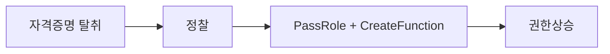

# 📝 침해사고 분석 보고서 — IAM 권한상승 (R3)

| 항목 | 내용 |
|---|---|
| **문서 번호** | IR-2026-R3-001 |
| **작성자** | 김신우 |
| **작성일** | <!-- TODO --> |
| **분류** | IAM 자격증명 탈취 · 권한상승 |
| **심각도** | <!-- TODO --> |
| **상태** | <!-- TODO: 종결 / 조치 중 --> |

> ℹ️ 본 보고서는 화이트햇스쿨 BYOC 프로젝트의 **통제된 실습 환경**에서 재현한 공격을 실제 사고 대응 보고서 양식으로 분석한 것입니다.

---

## 1. 요약 (Executive Summary)

> 비전문가도 이해할 수 있게 1페이지 이내로 — 사건 개요, 영향, 현재 상태

<!-- TODO -->

## 2. 사건 개요

| 항목 | 내용 |
|---|---|
| 탐지 경위 | |
| 최초 인지 시각 | |
| 대응 담당 | |
| 영향 받은 자산 | |

## 3. 타임라인

> 공격자 행위와 대응 행위를 시간순으로 · **가장 핵심 파트**

| 시각 (KST) | 구분 | 내용 | 근거 |
|---|---|---|---|
| | 🔴 공격 | | |
| | 🔵 탐지 | | |
| | 🟢 대응 | | |

## 4. 공격 분석

### 4.1 침투 경로

### 4.2 공격 흐름

### 4.3 MITRE ATT&CK 매핑

| 단계 | 전술 (Tactic) | 기법 (Technique) | 관찰 내용 |
|---|---|---|---|
| | | | |

### 4.4 목적 달성 여부

## 5. 증거 및 근거

> "왜 이렇게 판단했는지" 뒷받침하는 로그 · 스크린샷 · 명령어

<!-- TODO -->

## 6. IOC 목록

| 유형 | 값 | 비고 |
|---|---|---|
| IAM 역할 | | |
| Lambda 함수 | | |
| 출발지 IP | | |

## 7. 영향 범위 평가

<!-- TODO: 유출·변조·서비스 영향 / 피해 계정·시스템 -->

## 8. 조치 사항

### 8.1 초동 대응 (격리 · 차단)

### 8.2 제거 · 복구

## 9. 근본 원인과 재발 방지 대책

### 9.1 근본 원인 (Root Cause)

### 9.2 재발 방지 대책

| 구분 | 대책 |
|---|---|
| 단기 | |
| 중기 | |

## 10. 한계 및 미확인 사항

> 확인하지 못한 부분을 솔직하게 기록

<!-- TODO -->

---

### 참고

- 
